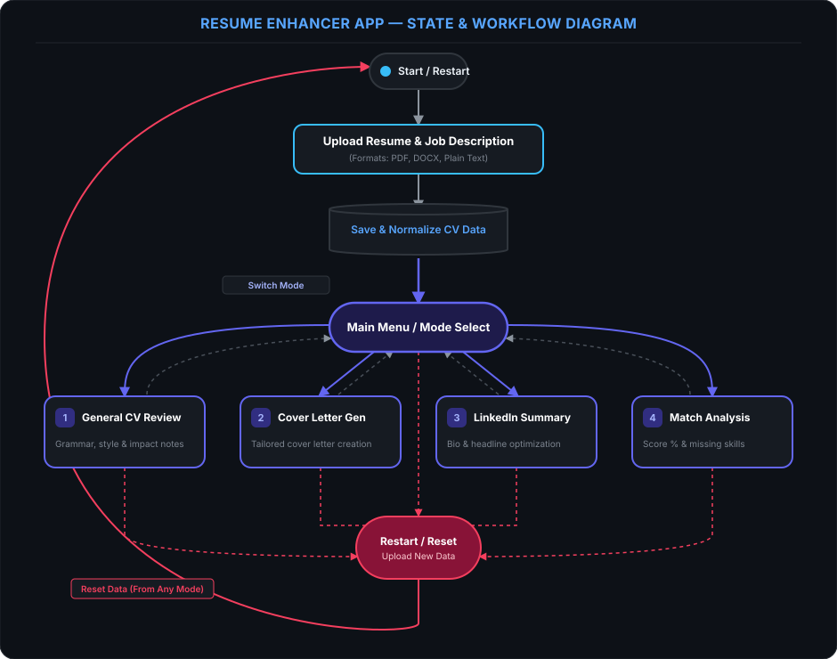

# Telegram Bot asistant for improvement Resume.

The bot uses the Google GenAI API to tailor career documents to a vacancy. Users can navigate across four modes, refine any result by sending corrections or adjustments, and reset the saved CV and vacancy. Facts the user explicitly confirms in a correction are treated as candidate-provided information even if they were not written in the uploaded CV. Temporary Gemini API errors (HTTP 429 and 5xx) are retried with bounded backoff; daily quota exhaustion is not retried and is reported to the user. Successfully generated tailored resumes are cached for repeated PDF downloads until the CV, vacancy, audit, or corrections change.

After an Audit Resume vs Vacancy result, users can download an AI-tailored resume as a PDF. The tailored resume uses the uploaded CV, vacancy, audit, and any corrections, and must not add unsupported facts.

Date comparisons use the current UTC date supplied to the model. Model output is requested as concise plain text without Markdown formatting.

State/Workflow diagrams:

<p align="center">
  
</p>


```mermaid
stateDiagram-v2
    [*] --> Start : Launch Application
    
    Start --> UploadData : Load Resume (PDF, DOCX, Text) & Job Description
    
    state "Data Processing" as DataProc {
        UploadData --> SaveCV : Parse & Extract Data
    }
    
    SaveCV --> MainMenu : Context Ready
    
    state "Operational Modes" as Modes {
        MainMenu --> GeneralCVReview : Select Mode 1
        MainMenu --> CoverLetterGen : Select Mode 2
        MainMenu --> LinkedInSummary : Select Mode 3
        MainMenu --> MatchAnalysis : Select Mode 4
        
        GeneralCVReview --> MainMenu : Switch Mode
        CoverLetterGen --> MainMenu : Switch Mode
        LinkedInSummary --> MainMenu : Switch Mode
        MatchAnalysis --> MainMenu : Switch Mode
    }

    state "Global Action" as Global {
        MainMenu --> ResetButton : Press Reset / Upload New
        GeneralCVReview --> ResetButton : Press Reset / Upload New
        CoverLetterGen --> ResetButton : Press Reset / Upload New
        LinkedInSummary --> ResetButton : Press Reset / Upload New
        MatchAnalysis --> ResetButton : Press Reset / Upload New
    }

    ResetButton --> Start : Reset & Upload New Data
```


TBD later: 
1. Profile photo improvement (separate model)
2. Create PDF with adjusted resume
