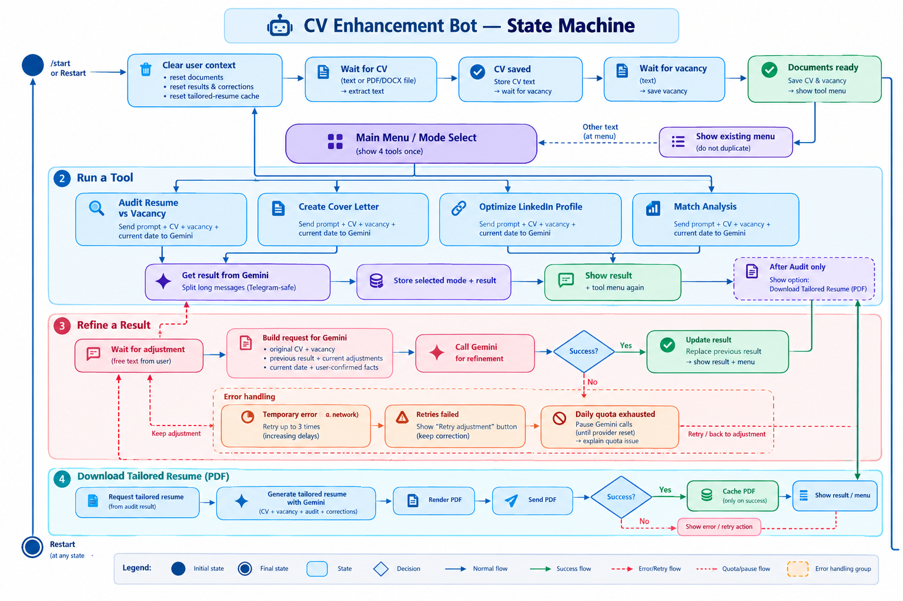

# Telegram Bot asistant for improvement Resume.

The bot uses the Google GenAI API to tailor career documents to a vacancy. Users can navigate across four modes, refine any result by sending corrections or adjustments, and reset the saved CV and vacancy. Facts the user explicitly confirms in a correction are treated as candidate-provided information even if they were not written in the uploaded CV. Temporary Gemini API errors (HTTP 429 and 5xx) are retried with bounded backoff; daily quota exhaustion is not retried and is reported to the user. Successfully generated tailored resumes are cached for repeated PDF downloads until the CV, vacancy, audit, or corrections change.

After an Audit Resume vs Vacancy result, users can download an AI-tailored resume as a PDF. The tailored resume uses the uploaded CV, vacancy, audit, and any corrections, and must not add unsupported facts.

Date comparisons use the current UTC date supplied to the model. Model output is requested as concise plain text without Markdown formatting.

## Application state and workflow

The bot keeps each user's CV, vacancy, selected mode, latest result, corrections, and tailored-resume cache in Telegram's user context.

1. Start and load documents
   - `/start` or Restart clears the saved user context and begins a new session.
   - The bot waits for a CV as pasted text or an uploaded PDF/DOCX file, extracts its text, and then waits for the vacancy description as text.
   - After both are saved, the bot displays the tool menu once. Sending other text while at this menu does not display a duplicate menu; the bot directs the user to the existing buttons.

2. Run a tool
   - The user selects Audit Resume vs Vacancy, Create Cover Letter, Optimize LinkedIn Profile, or Match Analysis using a button or command.
   - The bot sends the selected mode's prompt, CV, vacancy, and current UTC date to Gemini, then displays the result as plain text. Long results are split into Telegram-safe messages.
   - The bot stores the selected mode and result, then offers the tool menu again. After an audit, it also offers a tailored-resume PDF action.

3. Refine a result
   - After a tool returns a result, the bot waits for a free-text correction or adjustment.
   - Each refinement request includes the original CV and vacancy, the previous result, the current date, and all saved adjustments. Facts explicitly confirmed by the user are treated as candidate-provided facts, even when they were absent from the uploaded CV.
   - On success, the revised result replaces the previous result and the updated result can be refined again or used to generate the tailored resume.
   - On temporary Gemini errors, the bot retains the adjustment. HTTP 429 and 5xx errors are retried up to three attempts with increasing delays. If retries fail, the bot offers a Retry adjustment button.
   - Daily quota exhaustion is treated separately: it is not retried, further Gemini calls are paused in the running bot until the provider's estimated reset, and the bot explains the quota issue. The correction remains in the session.

4. Download the tailored resume
   - From an audit result, the user selects Download Tailored Resume (PDF).
   - Gemini generates a resume based on the CV, vacancy, latest audit, and saved corrections. The bot renders and sends it as a PDF.
   - A successful tailored resume is cached for subsequent PDF downloads while those source inputs remain unchanged. A failed generation is not cached.

5. Start over
   - Restart or `/start` clears the current user's documents, results, corrections, and generated-resume cache, then returns to CV upload.

# CV Enhancement Telegram Bot State Diagram

```mermaid
stateDiagram-v2
    [*] --> WaitingForCV : /start or Restart
    WaitingForCV --> WaitingForVacancy : CV text extracted or pasted
    WaitingForCV --> WaitingForCV : Invalid or unreadable CV
    WaitingForVacancy --> MainMenu : Vacancy saved
    WaitingForVacancy --> WaitingForVacancy : Vacancy missing

    MainMenu --> GeneratingResult : Select one of four tools or command
    GeneratingResult --> AwaitingAdjustment : Result returned and stored
    GeneratingResult --> MainMenu : Gemini request fails

    AwaitingAdjustment --> RefiningResult : Send correction or adjustment
    RefiningResult --> AwaitingAdjustment : Revised result returned and stored
    RefiningResult --> RetryAvailable : Temporary Gemini failure; adjustment retained
    RetryAvailable --> RefiningResult : Retry adjustment button
    RefiningResult --> QuotaBlocked : Daily quota exhausted; no retry
    QuotaBlocked --> RefiningResult : Quota reset and user retries

    AwaitingAdjustment --> GeneratingResume : Select tailored-resume PDF
    GeneratingResume --> AwaitingAdjustment : PDF sent or returned from cache
    GeneratingResume --> QuotaBlocked : Daily quota exhausted
    GeneratingResume --> AwaitingAdjustment : Other PDF generation error

    AwaitingAdjustment --> GeneratingResult : Select another tool
    MainMenu --> WaitingForCV : Restart or /start
    AwaitingAdjustment --> WaitingForCV : Restart or /start
    RetryAvailable --> WaitingForCV : Restart or /start
    QuotaBlocked --> WaitingForCV : Restart or /start
```

Profile photo improvement using a separate model remains a possible future feature. Tailored-resume PDF generation is implemented.
